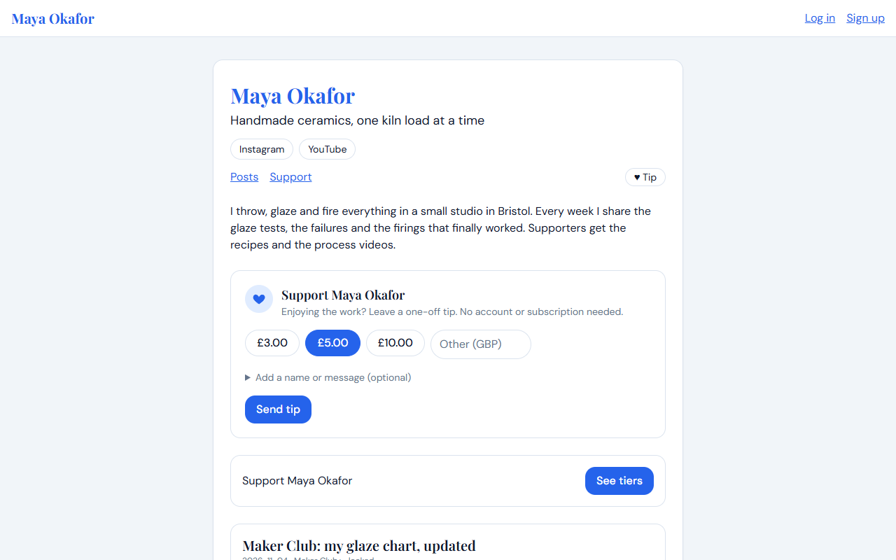
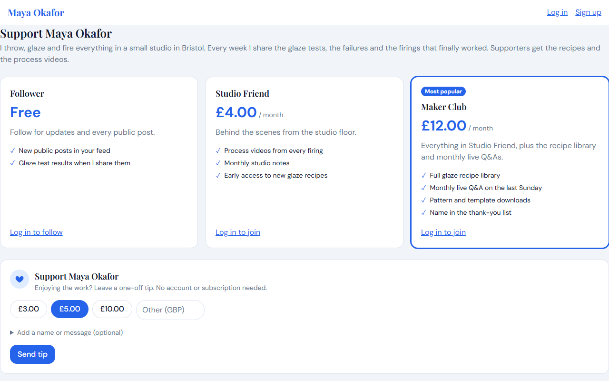
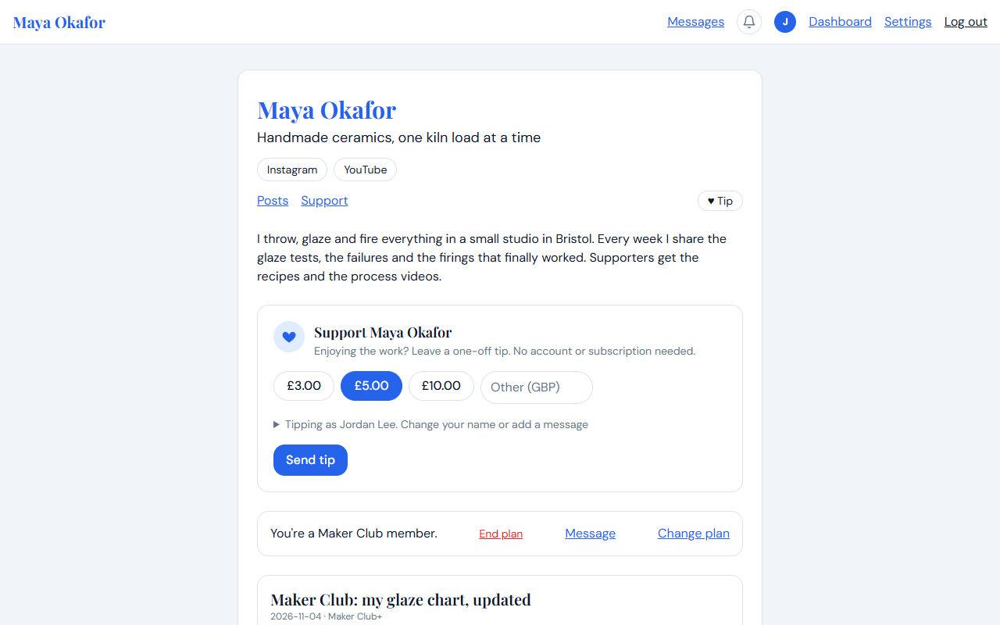
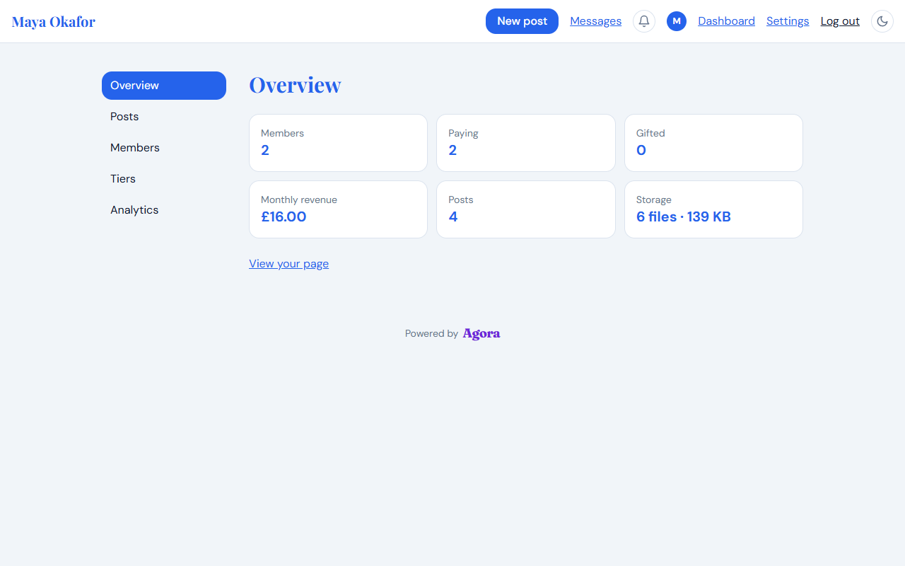
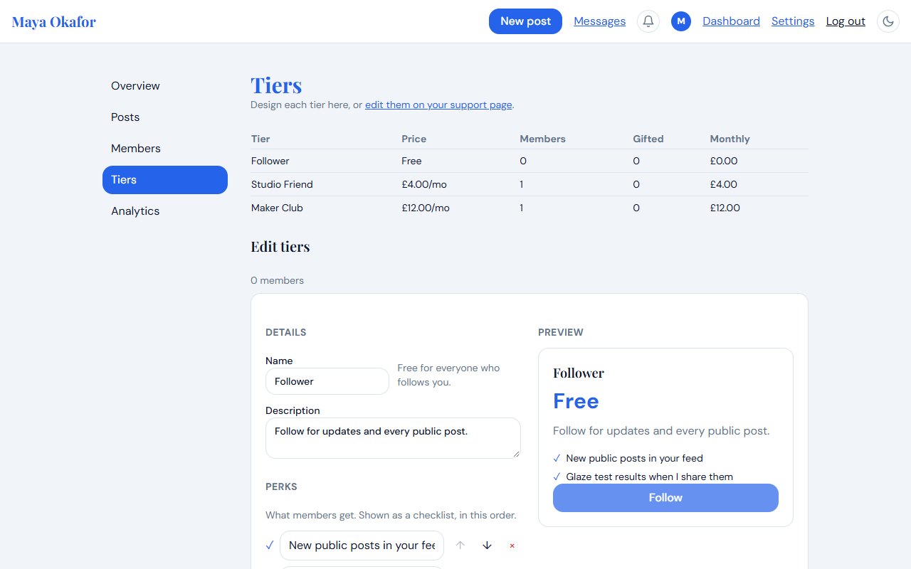
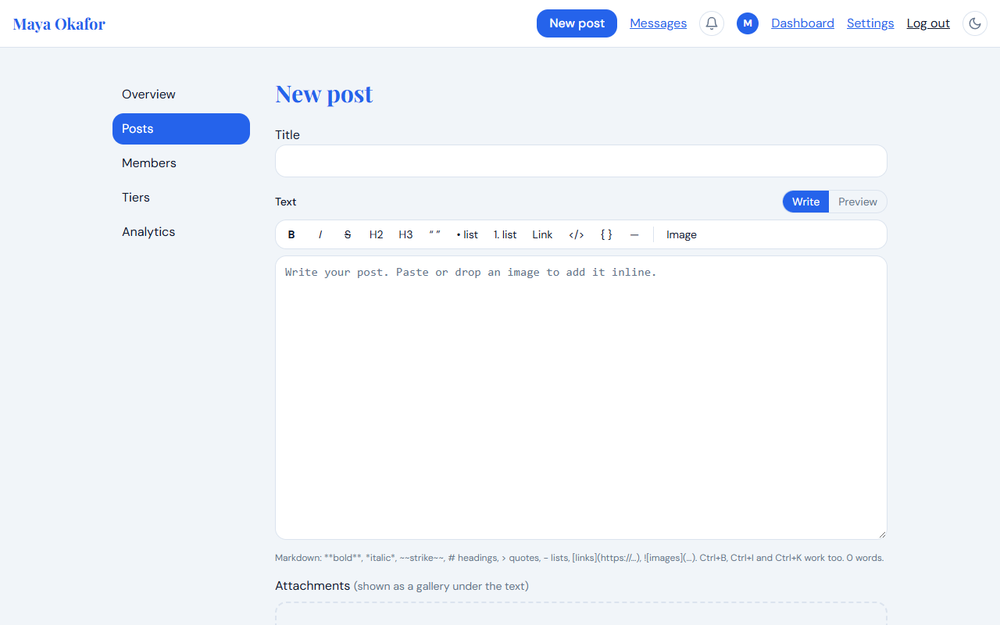

# Agora

Agora is an open-source, self-hosted platform for creators to publish work and
build direct relationships with their supporters. It aims to be a decentralized
alternative to Patreon, Ko-fi, or similar creator-fan platforms with control over hosting, data,
and presentation kept in the hands of each creator.

## Stack

- Next.js App Router and TypeScript
- Tailwind CSS
- Prisma ORM and PostgreSQL 18
- MinIO for S3-compatible media storage
- Docker Compose for self-hosted deployment

## Quick start

```sh
git clone https://github.com/pmcgurk/agora.git
cd agora
docker compose up -d
```

That single command builds the app, starts PostgreSQL and MinIO, creates the
private media bucket, applies database migrations, and starts Agora at
<http://localhost:3000>. Data lives in the `postgres_data` and `minio_data`
Docker volumes. The first start builds the image and takes a few minutes.

To try it with demo data, run `SEED_DEMO_DATA=true docker compose up -d` and log
in as `demo@agora.local` (creator) or `patron@agora.local` (patron) with the
password `demo-password`. Never seed a public instance.

## Configuration

`docker compose up` runs with development defaults. For anything beyond your own
machine, copy `.env.example` to `.env` and:

- MinIO's official Docker Hub images were removed, so the default image is the
  community fork `pgsty/minio` (override with `MINIO_IMAGE`). The app creates
  the media bucket on startup;
- change `POSTGRES_PASSWORD`, `MINIO_ROOT_USER` and `MINIO_ROOT_PASSWORD`;
- set `NEXT_PUBLIC_BASE_URL` and `MINIO_PUBLIC_ENDPOINT` to the URLs browsers
  use (use `https://`; presigned media links are signed for the MinIO URL);
- **create your creator account first.** The first account to sign up on a fresh
  instance becomes the creator, so do this before sharing the URL;
- for real payments set `STRIPE_SECRET_KEY` and `STRIPE_WEBHOOK_SECRET` (see
  [Payments with Stripe](#payments-with-stripe)). Without a Stripe key, set
  `ALLOW_FREE_SUBSCRIPTIONS=false` on a public instance (it enables a test checkout
  that takes no payment);
- put Agora behind an HTTPS reverse proxy. With an `https://` `NEXT_PUBLIC_BASE_URL`
  the container refuses to start with the default development passwords, and
  MinIO's admin console (port 9001) is only published on `127.0.0.1`.

## Payments with Stripe

1. Create a Stripe account and copy a secret key (`sk_test_...` while trying it out).
2. In Stripe → Developers → Webhooks add the endpoint
   `<NEXT_PUBLIC_BASE_URL>/api/stripe/webhook` with the events
   `checkout.session.completed`, `checkout.session.async_payment_succeeded`, `invoice.paid`,
   `invoice.payment_failed`, `customer.subscription.updated`, `customer.subscription.deleted`
   and `charge.refunded`.
3. Put the key and the endpoint's signing secret in `.env` as `STRIPE_SECRET_KEY` and
   `STRIPE_WEBHOOK_SECRET`, then `docker compose up -d`.
4. For local testing use the Stripe CLI: `stripe listen --forward-to localhost:3000/api/stripe/webhook`.
5. Enable the customer portal in Stripe settings so patrons can update cards and see invoices.

Agora creates a Stripe Product/Price for each paid tier on first use (and a new
Price when you change the amount or currency), sends patrons to Stripe Checkout,
and keeps plans in sync from webhooks. Ending a paid plan keeps access until the end of
the paid period; refunds issued from the Members page are real Stripe refunds. Card
data never touches Agora. The Stripe integration has been exercised against a mock
Stripe API, not a live account, so test it in Stripe test mode before going live.

### Testing locally

`stripe trigger payment_intent.succeeded` does not test Agora: it creates a payment that is not
linked to any creator or tier, and the current CLI fixture is rejected by newer accounts. Test with a
real Checkout instead:

1. Run `stripe listen --forward-to localhost:3000/api/stripe/webhook` and use the `whsec_...` it
   prints as `STRIPE_WEBHOOK_SECRET` (it changes each time you start `stripe listen`).
2. Use a test key (`sk_test_...`). A restricted key needs write access to Customers, Products,
   Prices and Checkout Sessions.
3. Turn on payments in Settings → Payments, make a paid tier, then subscribe or tip from a
   second account with card `4242 4242 4242 4242` (any future expiry and CVC). Card
   `4000 0000 0000 0341` attaches fine and then fails on renewal.

### Managed Payments and tax codes

Newer Stripe accounts have [Managed Payments](https://docs.stripe.com/payments/managed-payments)
(Stripe acts as the seller of record and handles sales tax) on by default, and it requires a
product tax code on everything sold. Agora sets `txcd_10000000` ("General - Electronically Supplied
Services") on the Products it creates for tiers and tips, so Checkout works whether Managed Payments
is on or off. Prices and tips are set as tax-inclusive, so a £10 tip is charged as £10 and any
tax Stripe applies comes out of that amount (the creator receives less) instead of being added on top.
Without this, Managed Payments adds tax to the checkout total (for example £12 for a £10 tip with 20%
VAT). Tier prices created by an earlier version without a code are replaced automatically the
next time someone subscribes. Managed Payments changes who is the merchant of record, and so fees,
payouts and which countries you can sell to; read Stripe's eligibility page before enabling it on a
live account, or switch it off under Settings → Managed Payments in the Stripe dashboard. If your
content is not "electronically supplied services" (for example physical goods), change `TAX_CODE` in
`src/lib/stripe.ts`.

## Email

Agora has an email framework for outgoing messages. For now a single-creator site only sends the
test message; notification emails will build on it. Set it up
in **Settings → Email** (owner only). Enter any SMTP server, press *Test connection and save*, and
send yourself a test. Settings saved there take precedence over environment variables, so changing
them needs no redeploy.

To configure by environment instead, set:

```sh
MAIL_HOST=smtp.example.com
MAIL_PORT=587
MAIL_SECURE=false        # true for port 465
MAIL_USER=you@example.com
MAIL_PASSWORD=...
MAIL_FROM=hello@example.com
```

Without any mail settings, Agora still works. Passwords for the mail server are stored in the database, like the Stripe key.

## Screenshots

Sample data for screenshots and trying Agora out (a ceramics creator with three tiers, posts with
inline images, two patrons and a few weeks of views):

```sh
npm run demo:seed   # point DATABASE_URL at an empty database first; refuses otherwise
```

Every demo account uses the password `demo-password`.

**The creator's page, as a visitor sees it**



**Tiers on the support page** (perks, a highlighted tier and a badge)



**A patron's feed**, with their membership and the posts they can read



**The creator dashboard, the tier editor and the writing editor**





## What works today

- Email and password accounts (creator or patron) with server-side sessions.
- Every creator gets a free "Follower" tier, so visitors can simply follow them.
  Creators add paid tiers on top.
- Posts take multiple photos, videos and audio files. Files upload straight from
  the browser to MinIO (drag and drop, progress, reorder), so large videos work;
  the cap is `MAX_UPLOAD_MB` (default 5 GB). Media never goes into PostgreSQL.
- Posts can be public or limited to a tier and above. Gated media is only served
  after an access check on every request: images through a 60-second presigned URL,
  video and audio streamed through the app (so a copied link can't be shared).
- Teasers for gated posts: viewers can "show blurred image" (made server-side from
  a tiny copy, so it can't be un-blurred) or watch the first N seconds of a video
  (a separate clip cut with ffmpeg, included in the Docker image).
- Creators can gift a tier to a patron (optionally expiring) and see stats:
  members per tier, gifted members, estimated monthly revenue and storage used.
- Posts can be edited and deleted (with confirmation). Locked videos show a thumbnail
  (blurred unless the creator chooses otherwise).
- One active plan per patron: choosing a tier replaces the previous one. The first
  account created on a fresh instance becomes the creator.
- Feed posts play video inline, expand images in a lightbox and show a clear
  "1 / N" badge when a post has several files.
- Pick body and heading fonts from a short Google Fonts list in Settings → Appearance
  (fonts load from Google at runtime).
- Block users, refund payments, and optional direct messages from patrons (toggle in
  Settings -> Privacy), which can be limited to members of a chosen tier and above.
- Profile pictures for everyone and a banner for the creator (Settings -> Profile).
  Uploads are re-encoded server-side (metadata stripped) and stored in MinIO.
- Supporters can end their plan; paid plans keep working until the period they paid for ends.
- Ko-fi style tips: creators switch on one-off tips in Settings -> Monetization. A "Support
  <creator>" card sits at the top of the creator's page (the home page on a
  single-creator instance), with a "Tip" link in the header and the same card on the Support
  page. Anyone can tip: guests need no account, and the optional name field (blank = shown as
  Anonymous) and message are all the creator sees. Tips go through Stripe Checkout
  (`mode: "payment"`; guests enter their email there for the receipt), show up under Payments on
  the Members page (refundable), notify the creator and fire the `tip.received` webhook.
  Guest tipping is rate limited per IP and unavailable on private instances.
  With no Stripe key and `ALLOW_FREE_SUBSCRIPTIONS=true`, tips are recorded without taking money.
- Public REST API with API keys and signed webhooks for every notification type (new posts,
  comments, likes, members, refunds, blocks, messages). Docs are in Settings -> API docs.
- On a single-creator instance the feed is the home page (`/`).
- Likes (from the feed too, and on comments) and comments on posts, visible to people who can see the post.
- A single-creator site: it is themed with the creator's theme, their name replaces "Agora" in the
  header, and visitors land on their page.
- One creator workspace: Overview, Posts, Members, Tiers and Analytics, then Settings (Profile,
  Appearance, Payments, Notifications, Privacy, Account), with rarely used technical pages (Email, API
  keys, Webhooks, API docs) under a collapsed "Advanced" group.
- Feeds load five posts at a time (3, 5, 10 or 20) with infinite scrolling, or Newer/Older pages, as the
  creator picks in Settings → Advanced → Feed. A "Load new posts" button appears on an open page when the
  creator publishes something new (checked every 30 seconds while the tab is visible). Long posts are clipped with a fade and a "View full post" link.
- Patrons can search a creator's posts. Titles are always searched; post text only in posts the
  searcher can open, so a search never reveals what is inside a locked post.
- Creators see an "Edit post" button on their own posts, in the feed and on the post page.
- Custom thank-you messages: one per tier (shown after someone joins) and one for tips (Settings → Payments).
- The setup wizard walks through connecting Stripe (API key, webhook, payouts) if it isn't connected yet.
- Switching tier replaces the old plan: the previous plan is ended straight away (and cancelled in Stripe),
  so a patron is never billed for two tiers of the same creator.
- Tiers can carry perks (a checklist), a badge such as "Most popular" and a highlight. Creators edit
  them on the Tiers page or directly on their support page.
- Posts are written in a Markdown editor with a toolbar, shortcuts and a live preview. Images can be
  dropped or pasted straight into the text.
- Creator dashboard with Overview, Posts, Members, Tiers and Analytics sections, and a
  "New post" button in the header. Settings cover profile, appearance, currency, privacy
  and account; patrons get their own subscriptions and account settings.
- Themes: light, dark and classic presets, or upload a JSON file with colors, radius,
  fonts and custom CSS targeting `agora-*` classes. Creators can hide the
  "Powered by Agora" footer.
- Private instances: only signed-in users can view anything (login and signup stay open).
- A "Support" page with the tiers in a grid (names, prices, descriptions), and a test
  checkout so the subscribe flow works without Stripe.
- Notifications (bell in the header, `/notifications`): creators hear about comments, likes and
  new followers or members (per tier); patrons hear about new posts and replies to their
  comments. Every kind can be switched off under Settings → Notifications. Comments support replies.
- Dark mode for the dashboard, settings and sign-in screens (toggle in the header).
- View counters (profile and per post) on the dashboard.

Not built yet: email verification, password reset, and federation (see the [roadmap](#roadmap)).
Login and sign-up are rate limited per process (in memory), which suits a single instance; also
rate limit at your reverse proxy if the instance is public.

## Roadmap

A running list of what would make Agora more useful, roughly in priority order. Nothing here is
promised; items move up when someone needs them. Contributions welcome (see
[CONTRIBUTING.md](./CONTRIBUTING.md)).

### Payments (highest priority)

- [ ] End-to-end test of Stripe Checkout in Stripe test mode: subscribe, tip, end plan, refund,
      and webhook retries. The current integration has only been exercised against a mock API.
- [ ] Automated tests for the webhook handler (signature failure, duplicate events, handler failure
      releasing the event claim) and for the access rules (`canView`, tier price comparisons).
- [ ] Handle `invoice.payment_failed` grace periods and tell patrons when a card is failing.
- [ ] Tax and VAT options beyond the default product tax code (see Managed Payments above), a setting for the tax code, and per-creator payout reporting (CSV export of payments and refunds).

### Email

- [ ] Plug in an email service (SMTP first, then Postmark/SES/Resend adapters) behind a single
      `lib/mail.ts` interface, configured via environment variables.
- [ ] Email verification at sign-up and password reset links (time-limited, single use).
- [ ] Notification emails for new posts and member events, with a per-user opt-in (the notification
      preferences already exist).
- [ ] Receipts and refund confirmations for patrons.

### Analytics

- [ ] Date-range picker (7, 30, 90 days, all time) and a total for the period.
- [ ] Conversion funnel: profile views → follows → paid members, with percentages.
- [ ] Revenue over time, churn (ended plans per month) and net new members, per tier.
- [ ] Traffic sources from referrers, stored as coarse domains only (no visitor identifiers).
- [ ] CSV export for all analytics tables.
- [ ] Per-post engagement over time, not just totals.

### Creator tools

- [ ] Scheduled posts and draft previews shared by link.
- [ ] Bulk actions on the Members page (message, gift or remove several members).
- [ ] Creator-to-member broadcast messages.
- [ ] Post search and tags; sort and filter on the Posts page.
- [ ] Import from Patreon/Ko-fi exports for members and posts.

### Patron experience

- [ ] Pagination or infinite scroll on the feed and comments.
- [ ] Email or in-app "new post" digest instead of only notifications.
- [ ] Downloadable receipts and an export of a patron's own data.

### Theming and presentation

- [ ] More built-in presets and a visual theme gallery.
- [ ] Separate light and dark palettes for a custom theme, following the visitor's system setting.
- [ ] Custom domains with automatic HTTPS, documented per reverse proxy.
- [ ] An accessibility pass: colour contrast checks in the colour editor, keyboard focus styles,
      and screen-reader labels on the analytics chart and tables.
- [ ] Mobile pass over the dashboard tables (Tiers and Analytics are tight at phone width; a stacked
      card layout would read better).

### Security and operations

- [ ] Nonce-based Content Security Policy so `script-src` no longer needs `'unsafe-inline'`.
- [ ] A scoped MinIO user for the app instead of the root account; document the policy.
- [ ] Pin the MinIO image by digest and offer the official image as an option once available.
- [ ] Rate limits that survive restarts and work across several instances (shared store).
- [ ] Account lockout messaging that doesn't reveal whether an email is registered.
- [ ] Atomic first-run setup, so two simultaneous requests can't create two creators.
- [ ] Automated backups of Postgres and MinIO, with a documented restore drill.
- [ ] Run `npm audit` and dependency updates on a schedule (Dependabot).

### Engineering

- [ ] A test suite in CI (unit tests for access and payment rules, end-to-end tests for signup,
      posting, subscribing and tipping).
- [ ] Health endpoint for monitoring (the container healthcheck currently just requests `/`).
- [ ] Structured logging with request IDs.
- [ ] Prebuilt container image published to a registry, so self-hosters don't need to build.
- [ ] Multi-stage Docker build to drop dev dependencies from the runtime image.

### Community

- [ ] Federation (ActivityPub) so creators can be followed from other fediverse servers. Not started.
- [ ] Translations and locale-aware currency and date formatting.

Security reports: see [SECURITY.md](./SECURITY.md).

See [CONTRIBUTING.md](./CONTRIBUTING.md) for local development.
